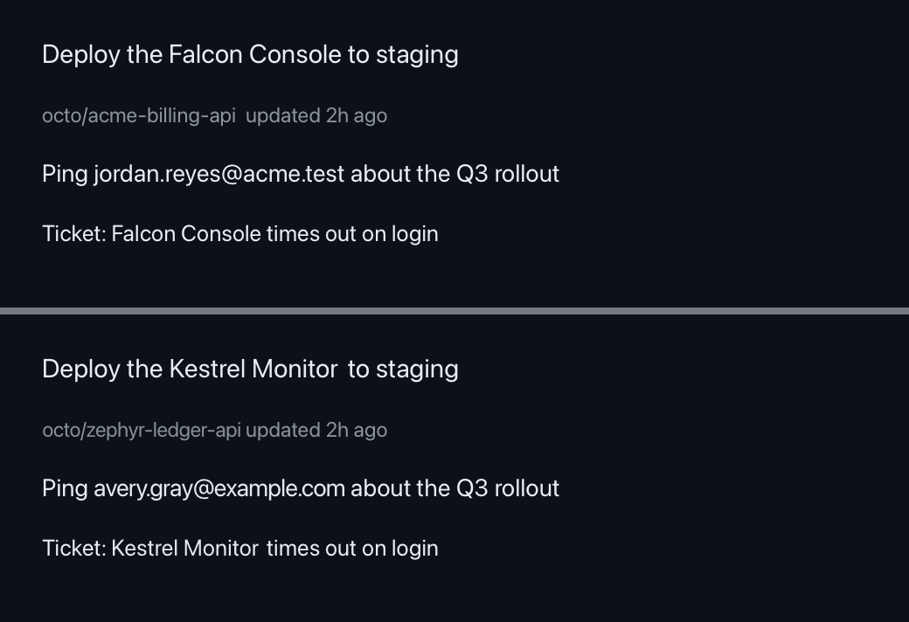
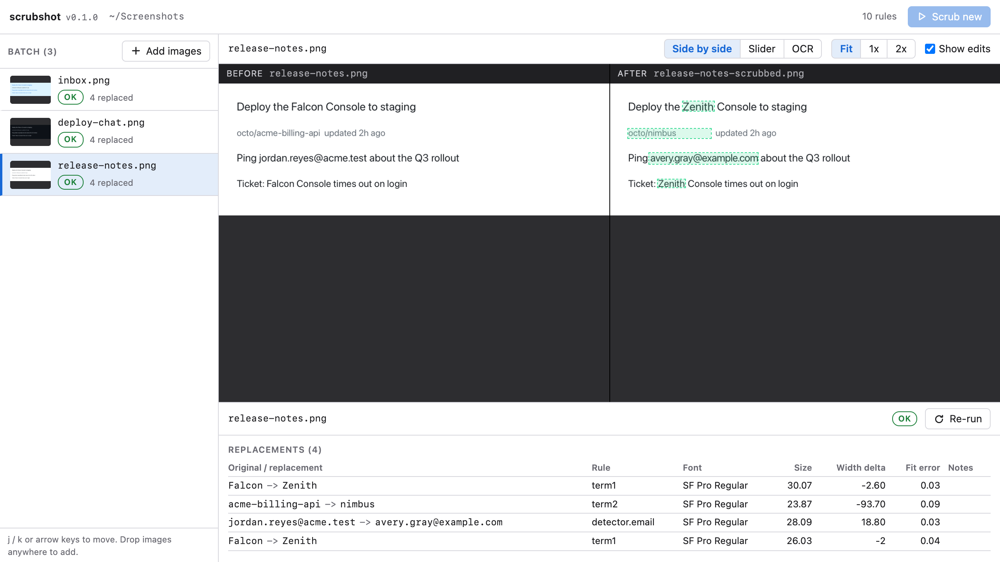

# scrubshot

Replace sensitive text in screenshots so they're safe to post. Names of companies,
clients, repos, products and people, plus emails and internal URLs, get swapped
for fake text drawn in the same font, size, color and position. Everything else
in the image stays exactly as it was.



- **Local only.** Apple Vision for OCR, CoreText for drawing. No network calls and
  no models beyond the OS.
- **Deterministic.** The same image and rules give byte-identical output. `auto`
  replacements are hash-picked, so a name maps to the same fake name in every
  screenshot of a series.
- **Surgical.** Only pixels inside the matched words change. A match inside a
  longer token (`octo/acme-billing-api`) keeps the untouched prefix when there is
  a clean gap to cut at.
- **Fails closed.** After drawing, scrubshot OCRs the output again (at 1x and 2x)
  and refuses to write it if any rule still matches, or if a redrawn area still
  reads as something one edit away from a replaced term. Exit code 2, no output.
- **Never touches the input.** Output goes to `<name>-scrubbed.png` next to it,
  or `-o path`. Metadata is stripped (only the color profile and DPI stay).

Requires macOS 14+ and Swift 6 (Xcode or Command Line Tools).

## Install

```sh
git clone git@github.com:buddyh/scrubshot.git && cd scrubshot
make install          # swift build -c release, then copy to ~/.local/bin/scrubshot
make install-skill    # optional: link the agent skill into ~/.claude/skills/scrubshot
```

The first run after a reboot can take a while (about 30s) while Vision loads its
models. After that a screenshot takes under a second.

## Use

```sh
scrubshot audit shot.png                 # every text line OCR finds, with boxes
scrubshot shot.png                       # uses ~/.config/scrubshot/rules.json
scrubshot a.png b.png -r work.json       # several files, extra rules
scrubshot shot.png --replace 'Globex=Initech' --term 'person:Hank Scorpio'
scrubshot shot.png --report              # also writes shot-scrubbed.report.json
scrubshot shot.png --dry-run --json      # what would change, nothing written
```

| Option | Meaning |
| --- | --- |
| `-o, --output <path>` | Output file (one input only). |
| `-r, --rules <file>` | Rules JSON, repeatable. The default file loads first unless `--no-default-rules`. |
| `--replace a=b` | Literal replacement, case-insensitive. |
| `--term [category:]text` | Stable fake replacement for `text`. |
| `--emails`, `--urls` (and `--no-…`) | Built-in detectors. |
| `--report` | JSON next to the output: each original, replacement, box, font, color, fit. Never embedded in the image. |
| `--json` | Machine-readable result on stdout. |
| `--dry-run` | Run everything, write nothing. |
| `--keep-failed` | On a failed leak check, still write `<name>-scrubbed-UNSAFE.png` for debugging. |
| `--ocr-scale n` | Upscale before OCR. Try 2 for small 1x text. |
| `--verify-scales 1,2` | OCR scales used by the leak check. |

Exit codes: `0` ok, `1` error, `2` leak check failed.

## Rules

`~/.config/scrubshot/rules.json` (see [examples/rules.example.json](examples/rules.example.json)):

```json
{
  "detectors": { "email": true, "url": true },
  "rules": [
    { "term": "Globex", "category": "company" },
    { "terms": ["Project Falcon", "project-falcon"], "category": "product" },
    { "regex": "globex-[a-z0-9-]+", "category": "repo" },
    { "term": "Hank Scorpio", "category": "person" },
    { "term": "GBX", "wholeWord": true, "replace": "ACME" },
    { "regex": "ticket-(\\d+)", "replace": "ticket-0000" }
  ]
}
```

- `term` / `terms`: literal text. Case-insensitive by default (`caseSensitive: true`
  to change), and tolerant of common OCR mix-ups (`l`/`I`/`1`, `0`/`O`). Spaces
  match any run of whitespace. Aliases in `terms` share one fake value, reshaped
  per match (`Project Falcon` and `project-falcon` might become `Harbor Lens` and
  `harbor-lens`).
- `wholeWord: true`: don't match inside longer words (`Orbis` but not `Orbisant`).
- `regex`: ICU regular expression. `replace` may use `$1`.
- `replace`: the replacement text, or `auto` (the default) for a stable fake value
  of the given `category`: `company`, `person`, `product`, `repo`, `acronym`,
  `email`, `url` or `word`. Fake values copy the original's casing and keep about
  its length. Emails become `…@example.com` and URLs `https://example.com/…`.

## Using it from an agent

scrubshot is built to be driven by a coding agent that picks fitting replacement
text: real-sounding names, PR titles that still read like PR titles, and
consistent names across a series. The loop:

1. `scrubshot audit shot.png --json` to read every line and span with pixel boxes.
2. The agent writes a rules file with its chosen replacements.
3. `scrubshot shot.png -r rules.json --dry-run --json` returns, per replacement,
   `render.widthDelta` (px wider (+) or narrower (−) than the original),
   `render.scale` (below 1 means it was shrunk to fit) and warnings. The agent
   tunes any that are far off.
4. Run without `--dry-run`. Exit 2 lists `leaks` to fix.

[skill/scrubshot/SKILL.md](skill/scrubshot/SKILL.md) is a ready-made Claude Code
skill for this loop (`make install-skill`). The tool stays local, but text the
agent reads from `audit` goes wherever that agent's model runs.

## Web UI

The CLI is the main interface; the web UI is for when you want eyes on a batch.

```sh
scrubshot serve ~/Screenshots --open      # http://127.0.0.1:7317
```



- It shows one folder. Every screenshot in it is a row with its status (new,
  queued, running, ok, leak, error). Drop images on the page to add and scrub them.
  "Scrub new" runs the rest.
- **Side by side** and **Slider** compare before and after. "Show edits" outlines
  every redrawn box, and leaks are drawn in red.
- **OCR** draws what Vision read over the original. Hover a box for its text,
  confidence and the rule it matched.
- The details panel lists each replacement with its font, size, width delta and
  fit error.
- Agents keep using the CLI with `--report` in the same folder. The page polls,
  so their runs show up as they finish.

The server listens on 127.0.0.1 only and rejects other Host headers. Writes need
an `X-Scrubshot: 1` header, and file names can't leave the folder. It uses the
same rules and options as `scrub`, and the same fail-closed check: a leak writes no
output.

## How it works

1. **OCR.** Vision `VNRecognizeTextRequest`, accurate level, language correction
   off (so names aren't "fixed"). Observations on one visual line are joined, so a
   term split across two observations still matches.
2. **Match.** Rules run on each line. A match is widened to whole words for
   drawing. Vision only gives word-level boxes, so cuts inside a word come from
   CoreText glyph offsets, snapped to a fully blank pixel column.
3. **Measure.** The background is the most common color around the word. The ink
   box is found by trimming and growing the Vision box. Each candidate font
   (SF Pro in four weights, SF Mono, Helvetica Neue, Menlo) is sized to the ink
   width, aligned by coverage centroid to a quarter pixel, and scored by how well
   its rendered coverage explains the real pixels.
4. **Agree.** Edits of similar size share one font (the lowest total error), and
   near-equal sizes snap to their median, so short words like `GLXIA` follow the
   rest of the screenshot.
5. **Draw.** The text color comes from a least-squares fit against the fitted
   coverage. The word is filled with the background (a row blend if the
   background isn't flat, with a warning). The replacement is drawn at the
   original pen position and baseline, clipped to the fill box, and tightened
   (then shrunk) if it would run into the next word.
6. **Verify.** OCR the output at 1x and 2x and fail on any rule match, or on
   anything one edit away from a replaced term inside a redrawn box.

## Limits

- Text over photos, gradients or textures: the fill is a left-to-right blend per
  row and can look smudged. You get a warning; check it by eye.
- A shorter replacement leaves a gap before the next word, because moving the rest
  of the line would change pixels outside the matched box. Pick replacements of
  about the same width (`widthDelta` in the report).
- Very small text (under about 9 px tall) OCRs less reliably. Try `--ocr-scale 2`.
  If OCR misses a term in the input, it can't be replaced. The 2x leak check
  catches many of these and fails the run.
- Fonts outside the candidate list get the closest match. Rotated text,
  vertical text and text with effects (shadows, outlines) aren't handled.
- Output is PNG. JPEG input is decoded and written as PNG.

## Development

```sh
make test       # unit tests plus synthetic screenshots (light, dark, tinted at 1x and 2x)
make fixtures   # rewrite Tests/Fixtures/*.png
SCRUBSHOT_DEBUG=1 scrubshot shot.png   # print font-fit details per edit
```
